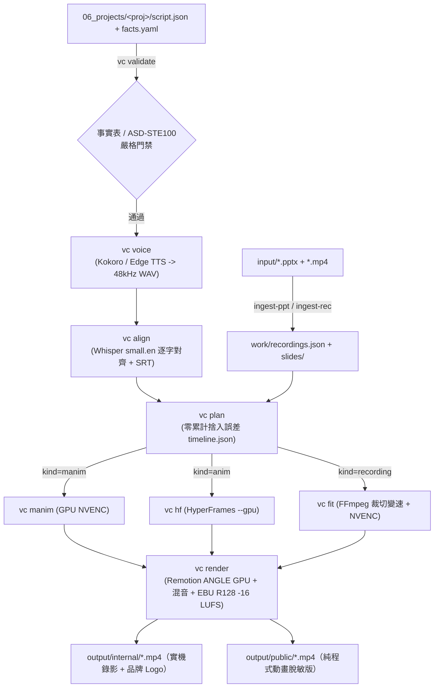

# 系統架構與目錄設計（`00_docs/01_architecture.md`）

本專案採用「**旁白文字驅動精準影格**」的確定性剪片架構。傳統人工剪片會因修改一句台詞而迫使後面全部畫面與音效錯位；本管線將 `script.json` 視為唯一單一真值來源，由時間軸自動重算一切視覺與字幕時間點。

## 1. 端到端資料流

## 2. 為什麼採用 `00_` ~ `09_` 編號目錄？

這套編排遵循 AI 開發工程的最佳實踐，讓使用者與 AI Agent 進到倉庫就能依「規則 → 流程 → 技能 → 風格 → 參考 → 實作 → 測試」順序定位檔案：

| 目錄 | 用途與定位 | 是否進 Git |
| :--- | :--- | :--- |
| `00_docs/` | 給人看的使用手冊、架構圖、環境安裝、GPU 說明與 Brief 範本 | 是 |
| `01_rules/` | 寫給人與 Agent 的硬性規則（核心紀律、ASD-STE100、ISO 24495-1、影音規格） | 是 |
| `02_workflows/` | BMAD + BDD 開發生命週期與多代理協作流程 | 是 |
| `03_skills/` | 可重用領域技能包（同步鏡像於 `.agents/skills/` 供 Agent 載入） | 是 |
| `04_styles/` | 視覺風格包（每套含 `STYLE.md` + `style.json`） | 是 |
| `05_references/` | `lemo-opuscar`、`anatomy`、`hyperframes` 與 Remotion 生態深度分析 | 是 |
| `06_projects/` | 各別影片專案資料夾（預設僅保留 `_sample` 與 `_sample_exec`） | 僅範例 |
| `07_features/` | Gherkin `.feature` 行為規格（定義管線「做對什麼事」） | 是 |
| `08_tests/` | `pytest-bdd` 自動化測試與靜態回歸門禁 | 是 |
| `09_scripts/` | 環境重建 `setup.ps1`、模型冒煙測試與畫面抽幀檢查工具 | 是 |
| `vc/` & `remotion/` | 核心 Python CLI 套件與 Node.js Remotion 合成器（維持不編號確保模組載入相容） | 是 |

## 3. 雙軌隱私分流（`internal` vs `public`）

在企業或客戶現場製作技術教學時，同一套腳本往往需要輸出兩個版本：
- **`internal`（內部培訓版）**：允許穿插真實軟體螢幕錄影（`kind: recording`）、投影片原圖與單位品牌標誌。
- **`public`（外部開源或公開版）**：由 `vc validate` 與 BDD 測試強制把關，`public` 版只能包含重新繪製的向量動畫（Manim 或 HyperFrames SVG），嚴禁出現真實軟體畫面、圖片檔名或私有 Logo。
