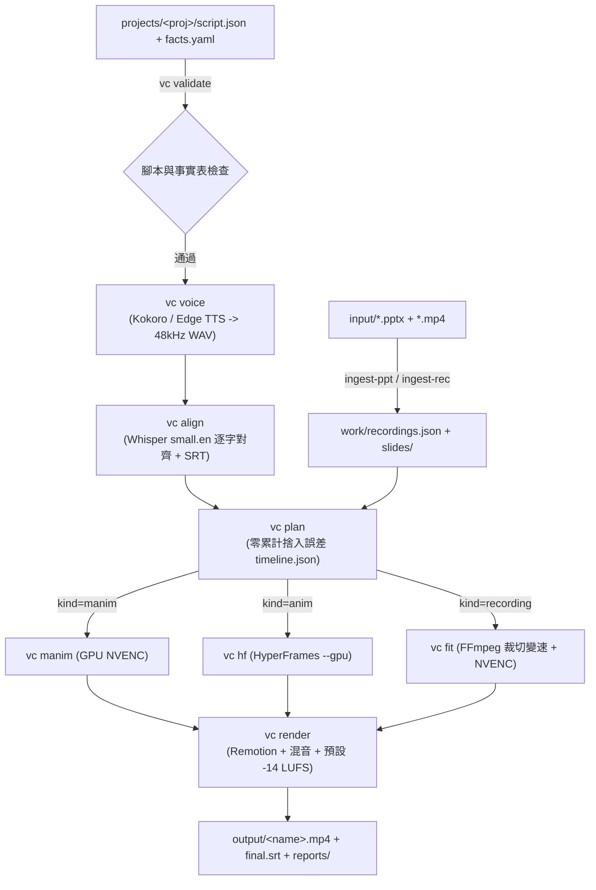

# 系統架構與目錄設計

本專案採用「**旁白文字驅動精準影格**」的確定性剪片架構。傳統人工剪片會因修改一句台詞而迫使後面全部畫面與音效錯位；本管線將 `script.json` 視為唯一單一真值來源，由時間軸自動重算一切視覺與字幕時間點。

## 1. 端到端資料流

## 2. 目前目錄分工

倉庫已移除舊版數字目錄前綴。以下路徑以目前實際目錄為準：

| 目錄 | 用途與定位 | 是否進 Git |
| :--- | :--- | :--- |
| `docs/` | 使用手冊、架構、環境安裝與 Brief 範本 | 是 |
| `rules/` | 人與 Agent 的開發及影音規則 | 是 |
| `workflows/` | 開發生命週期與新影片 SOP | 是 |
| `skills/` | 可重用領域技能包 | 是 |
| `styles/` | 風格設定與 Jinja2 動畫範本 | 是 |
| `docs/references/` | 開源生態參考分析 | 是 |
| `projects/` | 自包含影片專案；私人專案預設忽略 | 僅範例 |
| `tests/features/` | Gherkin 行為規格 | 是 |
| `tests/` | BDD、單元與整合測試 | 是 |
| `scripts/` | 安裝、模型冒煙測試與維護工具 | 是 |
| `assets/` | 共用圖片、品牌與音訊素材 | 依素材設定 |
| `vc/` & `remotion/` | 核心 Python CLI 套件與 Node.js Remotion 合成器（維持不編號確保模組載入相容） | 是 |

## 3. 單一影片與產物有效性

每個場景以 `visual` 指定 `recording`、`anim` 或 `manim`，最後輸出一支影片。舊雙版本腳本先執行 `python -m vc migrate <project>`；原始檔會備份為 `script.json.bak`。

管線檢查腳本、音檔、匯入素材、風格與動畫的來源指紋。若輸入已變更，後續階段會要求重建過期產物。正式渲染缺少必要片段時會失敗；新成品通過影格、音訊與響度檢查後，才取代同名舊成品。

目前範例腳本位於 [`projects/_sample/script.json`](../projects/_sample/script.json) 與 [`projects/_sample_exec/script.json`](../projects/_sample_exec/script.json)。範例不含原始簡報與錄影，完整製片前需自行準備素材。
