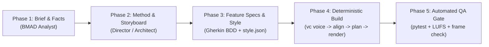

# BMAD + BDD 影片開發生命週期

本專案將軟體工程的 **BMAD（Breakthrough Method for Agile AI-Driven Development）** 與 **BDD（行為驅動開發，Gherkin `.feature`）** 結合到自動化剪片流程中，讓每一秒畫面與每一組數據都可追溯、可測試、可重現。



## Phase 1：Brief 與 Fact Table（真值來源確立）

- 填寫專案需求書（見 [需求範本](../docs/04_project_brief_template.md)），定義目標觀眾、影片用途與秒數上限。
- 盤點真實素材與數據，寫入 `projects/<name>/facts.yaml`：
  - 每個數字必須附上原始出處 `sources`（錄影時間戳或文件頁碼）。
  - 主管精簡版必須將所有條目補上 `scope` 與 `shown` 並啟用 `strict_facts: true`。
  - 未親自確認的數據不得將 `confirmed` 設為 `true`。

## Phase 2：Method 與 Storyboard（分段與資產配對）

- 選用標準 7 段結構（完整教學 ~150s）或 5 段結構（主管精簡 ~75s）。
- 為每個場景配置一個 `visual`，選擇錄影（`recording`）、HyperFrames 動畫（`anim`）或 Manim（`manim`）。發布前審查素材。
- 挑選視覺主題風格（見 [`styles/`](../styles/)）。

## Phase 3：Feature Specs 與 Script Validation（BDD 測試先行）

- 若新增了場景樣板、字數預算或驗證規則，先在 [`tests/features/`](../tests/features/) 新增對應 Gherkin 情境，並在 [`tests/bdd/`](../tests/bdd/) 補齊步驟實作。
- 編輯 `projects/<name>/script.json`，執行前置驗證：
  ```powershell
  .venv\Scripts\python.exe -m vc validate <project>
  ```
- 必須零錯誤才可進入語音合成階段。

## Phase 4：Deterministic Build（配音驅動時間軸）

依序執行確定性管線（詳細指令見 [`01_new_video_sop.md`](01_new_video_sop.md)）：
1. `ingest-ppt` / `ingest-rec`：提取投影片高清圖與錄影場景活動圖。
2. `voice`：依據詞典 `lexicon` 合成各段 48kHz 單聲道旁白。
3. `align`：使用 Whisper 取得毫秒級單字時間戳並產生英文字幕。
4. `plan`：將旁白長度轉換為 **零累積捨入誤差** 的整數影格 `timeline.json`。
5. `manim` / `hf` / `fit`：各自依 `timeline.json` 輸出精準影格的動畫與錄影片段。
6. `render`：透過 Remotion 合流成片，完成 EBU R128 響度標準化。

## Phase 5：Automated QA & Close-Up Audit

- 執行 `.venv\Scripts\python.exe -m pytest -q` 確認所有管線契約回歸無誤。
- 以 `scripts/grab_frames.py` 抽取關鍵轉場幀檢查文字邊界與等軸圖表無重疊。
- 核對輸出影格數與響度報告；預設目標為 `-14.0 LUFS`，可於專案設定中調整。
